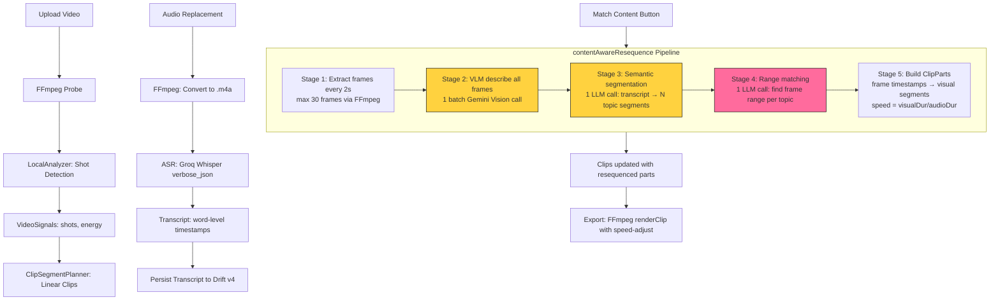

# Technical Review: Project Match Konten — Progress Report

**Tanggal:** 2026-10-12  
**Branch:** `feature/s18-caption-reframe-sidebar`  
**Commit terakhir:** `6a13ad0` — fix(s17): skip per-frame fallback on transient 503/429  
**Reviewer:** Hermes Agent (automated codebase audit)  
**Basis:** Verifikasi langsung kode `visary_app/lib` + `flutter analyze lib` (0 issues) + `flutter test` (231 pass) + log runtime `/tmp/visary_app.log`

**Keterbatasan audit:**
- Audit dilakukan dari source code dan test otomatis. Pengujian end-to-end dengan video nyata dan verifikasi visual hasil match content belum dijalankan karena Gemini Vision API mengalami 503 (high demand) saat pengujian.
- Estimasi biaya API berdasarkan tarif publik Google/Groq/OpenAI, bukan pengukuran terukur dari penggunaan aktual.
- Verifikasi akurasi matching (precision/recall) belum tersedia — tidak ada dataset berlabel.

---

## 1. Status Project

### Tujuan dan Ruang Lingkup MVP

Visary adalah AI short-form video clip generator (Flutter desktop app) yang mengekstrak klip pendek dari video panjang. Fitur **Match Konten** (content-aware audio-visual matching) bertujuan menyelaraskan visual video dengan narasi audio pengganti: audio membahas topik "hot pot" → visual menampilkan hot pot, bukan visual lain.

### Tabel Status Fitur

| Fitur | Status | Progress | Dasar Penilaian |
|-------|--------|----------|-----------------|
| Frame extraction (FFmpeg) | ✅ Selesai | 100% | `VideoService.extractFrame` — ekstrak frame pada timestamp tertentu. Test: `frame_extraction_test.dart` (4 test pass) |
| Frame sampling tiap 2s | ✅ Selesai | 100% | `app_state.dart:720-734` — `frameInterval = 2.0`, max 30 frames. Kode tertulis, analyze 0 |
| VLM frame description (batch) | ✅ Selesai | 90% | `content_matcher_service.dart:24-95` — batch 1 API call via `visionBatchPrompt`. Per-frame fallback untuk non-transient error. Test mock: `content_matcher_test.dart` (12 test). Gap: belum teruji dengan API nyata (503 saat test) |
| Semantic audio segmentation | ✅ Selesai | 85% | `content_matcher_service.dart:53-190` — `segmentByContext` 1 LLM call. Test: `semantic_segmentation_test.dart` (7 test). Gap: prompt truncate >500 kata |
| Range-based content matching | ⚠️ Prototype | 60% | `content_matcher_service.dart:368-458` — `matchContentRanges` LLM returns `[startFrame, endFrame]` per topic. Kode tertulis + analyze 0. **TIDAK ada test unit** untuk method ini |
| Frame range → ClipPart conversion | ⚠️ Prototype | 60% | `resequence_service.dart:166-231` — `buildPartsWithFrameRanges`. Visual range dari frame timestamps, speed-adjust clamped 0.25x-4x. **TIDAK ada test unit** |
| Speed-adjust visual to audio | ✅ Selesai | 100% | `resequence_service.dart:208` — `rawSpeed = (vEnd - vStart) / audioDur`, clamp 0.25-4.0. Test: `resequence_segments_test.dart` (10 test) |
| Fallback chain | ✅ Selesai | 95% | 5-level fallback: LLM range → even split → S16 segments → S13 timing → sequential. Test: `fallback_chain_test.dart`, `resequence_content_aware_test.dart` (9 test) |
| BYOK multi-provider | ✅ Selesai | 100% | `ai_provider_service.dart` (1115 baris) — Gemini/OpenAI/Groq/Custom. Auto-switch per task (S17). Test: `ai_provider_service_test.dart`, `auto_switch_routing_test.dart` |
| ASR (Whisper via Groq) | ✅ Phase 1 | 80% | `ai_provider_service.dart:900-1115` — multipart verbose_json, word-level timestamps. Transcript persist ke Drift v4. Gap: TTS, Gemini inline-audio, audio chunking >20MB |
| Transcript export (.SRT/.TXT) | ✅ Selesai | 100% | `models.dart:345-378` — `toSrt()`, `toTxt()`. Test: `transcript_export_test.dart`, `transcript_test.dart` |
| Audio replacement + preview sync | ✅ Selesai | 95% | `AudioMode` enum, `renderClip` audioMode, `muxPreviewAudio`. Test: `audio_mode_test.dart`, `audio_panel_test.dart`. Gap: `renderWithBroll` belum terima `audioMode` |
| UI: Match Content button | ✅ Selesai | 90% | `audio_panel.dart:152-191` — `_matchContent()` dengan progress stages. Test: `audio_panel_match_button_test.dart` (5 widget test) |
| Caption & Reframe sidebar (S18) | ✅ Selesai | 85% | `caption_reframe_panel.dart` — sidebar 320px, live caption overlay sync playhead. Test: `transcript_export_button_test.dart` (3 test). Gap: overflow 277px di top bar (RenderFlex) |

### Perubahan Terakhir

| Commit | Deskripsi | Sprint |
|--------|-----------|--------|
| `6a13ad0` | Skip per-frame fallback on transient 503/429 — return empty descriptions, pipeline continues visual-only | S17 fix |
| `4c4c33e` | Batch vision API calls (1 call untuk semua frame) + retry 429/503 dengan API delay dari response | S17 fix |
| `c4ad3fd` | Content matching pakai real shot timestamps, bukan equal-duration chunks | S16 fix |
| `8bb8105` | Caption & Reframe in-editor sidebar — hapus CaptionReframeScreen, ganti Asset sidebar | S18 feat |

### Pekerjaan Berikutnya
1. Test unit untuk `matchContentRanges` + `buildPartsWithFrameRanges` (saat ini 0 test)
2. Validasi end-to-end match content dengan video nyata (Gemini 503 blocking)
3. Fix top bar overflow (RenderFlex 277px)
4. Update EXECUTION-ORDER-PRD.md status untuk S18

---

## 2. Arsitektur Aktual

### Stack Teknologi

| Komponen | Teknologi | Versi/Model |
|----------|-----------|-------------|
| Bahasa | Dart | 3.13.5 |
| Framework | Flutter | 3.47.6 stable |
| Desktop | Linux (Wayland) | Arch 7.2.3 |
| Video processing | FFmpeg (sidecar) | via `VideoService` |
| Video player | fvp (MDK) | 0.39.0 |
| Database | Drift (SQLite) | v4 schema |
| Secure storage | flutter_secure_storage | KWallet/libsecret |
| AI Vision | Gemini Flash (inline_data) | `gemini-flash-latest` |
| AI LLM | Gemini Flash / OpenAI gpt-4o-mini / Groq llama-3.1-8b-instant | Auto-switch per task |
| AI ASR | Groq Whisper / OpenAI Whisper-1 / Gemini (estimasi) | `whisper-large-v3` (Groq) |

### Struktur Folder

```
visary_app/lib/
├── main.dart                      # Entry point, routing, Drift init
├── models/
│   └── models.dart                # 403 baris — Clip, ClipPart, Transcript, WordToken, TranscriptSegment
├── services/
│   ├── ai_provider_service.dart   # 1115 baris — BYOK router, Gemini/OpenAI/Groq/Custom
│   ├── content_matcher_service.dart # 470 baris — VLM describe, segment, match ranges
│   ├── resequence_service.dart     # 339 baris — buildParts, speed-adjust, frame ranges
│   ├── video_service.dart          # 711 baris — FFmpeg extractFrame, renderClip, muxAudio
│   ├── local_analyzer.dart         # 401 baris — shot detection, energy, VideoSignals
│   ├── ai_service.dart             # B-roll keyword generation
│   ├── thumbnail_cache.dart        # Timeline thumbnail cache
│   └── ...
├── state/
│   └── app_state.dart              # 1051 baris — orchestrator, contentAwareResequence pipeline
├── screens/
│   ├── clip_editor_screen.dart     # 877 baris — main editor, video preview, caption sidebar
│   ├── audio_panel.dart            # 395 baris — match content button, transcribe button
│   └── ...
├── widgets/
│   ├── caption_reframe_panel.dart  # 441 baris — caption/reframe sidebar (S18)
│   ├── pro_timeline.dart           # 648 baris — timeline editor
│   ├── export_dialog.dart          # Export modal
│   └── ...
├── data/local/
│   ├── database.dart               # 219 baris — Drift schema v4
│   └── project_repository.dart     # 249 baris — load/save projects + transcripts
└── theme/
    └── tokens.dart                 # 116 baris — Neo-Brutalism design tokens
```

### Diagram Alur Aktual



### Komponen Lokal vs Cloud API

| Komponen | Lokal | Cloud API |
|----------|-------|-----------|
| Video probe (FFmpeg) | ✅ | — |
| Shot detection | ✅ `LocalAnalyzer` | — |
| Frame extraction | ✅ `VideoService.extractFrame` | — |
| Frame description (VLM) | — | ✅ Gemini Vision (batch) |
| Audio transcription (ASR) | — | ✅ Groq Whisper / OpenAI |
| Semantic segmentation (LLM) | — | ✅ Gemini / OpenAI / Groq |
| Content range matching (LLM) | — | ✅ Gemini / OpenAI / Groq |
| Speed-adjust calculation | ✅ `Resequencer` | — |
| ClipPart building | ✅ `Resequencer` | — |
| Video render/export | ✅ `VideoService.renderClip` | — |
| Persistence | ✅ Drift/SQLite | — |

---

## 3. Mekanisme Pencocokan Visual dan Audio

### 3.1 Audio Extraction & Transcription

**Status: ✅ Bekerja (Phase 1)**

**File:** `ai_provider_service.dart:900-1115`, `app_state.dart:320-340`

Alur:
1. User upload audio replacement via AudioPanel → file disimpan ke workspace
2. Audio dikonversi ke `.m4a` via FFmpeg (format kompatibel ASR)
3. ASR request: multipart upload ke Groq Whisper `whisper-large-v3` dengan `response_format=verbose_json`
4. Response berisi `word-level timestamps`: setiap kata punya `start` dan `end` dalam detik
5. Transcript disimpan ke `VideoSignals.transcript` (in-memory) + Drift `transcripts` table (persist)

**Timestamp preservation:**
- `WordToken` model: `{word: String, start: double, end: double}` — timestamps dalam detik
- Persist: Drift v4 `transcripts` table menyimpan JSON `words` array
- Setelah app restart: `loadProjects` restore transcript dari DB → `_signals[pid]!.transcript`

**Gap:**
- Audio >20MB belum di-chunk sebelum ASR (akan fail jika provider reject)
- Gemini inline-audio ASR belum diimplementasi (TODO di `ai_provider_service.dart:548`)
- B-Roll render belum terima `audioMode` (B-roll + audio replacement tidak terintegrasi di export)

### 3.2 Frame Selection Strategy

**Status: ✅ Bekerja (S18 redesign)**

**File:** `app_state.dart:711-755`

Strategi: **Fixed interval sampling** — 1 frame setiap 2 detik.

```dart
const frameInterval = 2.0; // seconds
for (double s = frameInterval / 2; s < videoDuration; s += frameInterval) {
  frameTimestamps.add(s);
}
// Limit max 30 frames
if (frameTimestamps.length > 30) { /* subsample evenly */ }
```

**Sebelumnya (S14-S16):** 1 frame per shot boundary (midpoint). Masalah: shot boundary bisa berisi multiple visual contexts.

**Sekarang (S18):** Uniform sampling — lebih granular, setiap 2 detik ada 1 sample visual. Max 30 frames untuk mitigasi API cost.

**Verification:** Kode tertulis dan ter-analyze (0 issues). Ekstraksi frame via FFmpeg `VideoService.extractFrame` teruji (`frame_extraction_test.dart`, 4 test pass).

### 3.3 Visual-Text Embedding & Similarity

**Status: ❌ Tidak digunakan**

Tidak ada embedding model. Tidak ada vector similarity computation. Pendekatan: **pure LLM text matching** — VLM menghasilkan deskripsi tekstual per frame, LLM mencocokkan deskripsi tersebut dengan topik audio segmen.

**Inferensi (perlu konfirmasi):** Pendekatan LLM text matching lebih fleksibel daripada embedding similarity (handle konteks abstrak, sinonim), tapi kurang deterministik dan lebih mahal per call.

### 3.4 Visual Relevance Determination

**Status: ⚠️ Prototype (S18 range matching)**

**File:** `content_matcher_service.dart:368-458`

Sistem menentukan visual relevan via LLM prompt:

```
For each audio segment, find the CONTIGUOUS range of visual frames
that best shows its topic. The visual should persist until the audio
topic changes. All frames must be covered (no gaps, no overlaps).
Return ONLY a JSON array of [startFrame, endFrame] pairs.
```

- **Relevan:** LLM return `[startFrame, endFrame]` — range frame yang deskripsinya match dengan topic
- **Tidak relevan:** Frame di luar range tidak ditampilkan untuk audio segment tersebut
- **Ambigu:** Tidak ada handling eksplisit. LLM memilih range terbaik berdasarkan deskripsi. Bila semua frame ambigu → fallback `fallbackRanges` (even split)

**Gap:** Tidak ada confidence score. Tidak ada threshold untuk "no match found" — selalu return range, bahkan bila match buruk.

### 3.5 Visual Timestamp ↔ Audio Segment Pairing

**Status: ✅ Bekerja (S18)**

**File:** `resequence_service.dart:166-211`, `app_state.dart:816-830`

```
Audio segment i: topic "hot pot", startSec=0s, endSec=9s, duration=9s
Frame range: [0, 2] → frames 0,1,2
Frame timestamps: [1s, 3s, 5s]

Visual segment:
  vStart = frameTimestamps[0] = 1s
  vEnd = midpoint(frameTimestamps[2], frameTimestamps[3]) = (5+7)/2 = 6s
  visualDuration = 6-1 = 5s

Speed = visualDuration / audioDuration = 5/9 = 0.56x (perlambat)
ClipPart(vStart=1, vEnd=6, speed=0.56)
```

Visual "hot pot" [1-6s] di-play 0.56x speed → durasi output ~9s → match dengan audio 9s.

### 3.6 Handling Visual Pendukung, Narasi Abstrak, Perpindahan Adegan

| Kasus | Status | Implementasi |
|-------|--------|--------------|
| Visual pendukung (B-roll) | ✅ Bekerja (S05) | `AiService.detectAndEnrichGaps` — deteksi gap visual statis, generate keyword B-roll via LLM. `renderWithBroll` overlay FFmpeg. **Gap:** belum terintegrasi dengan `audioMode` |
| Narasi abstrak (topik tidak visible di video) | ❌ Tidak ditangani | LLM tetap return range frame. Tidak ada mekanisme "topik tidak match visual manapun" → fallback even split |
| Perpindahan adegan (scene transition) | ⚠️ Prototype | Frame range matching handle ini: audio topic berubah → frame range berubah. Tapi akurasi tergantung VLM description quality + LLM matching quality. Belum teruji dengan video nyata |

---

## 4. Penggunaan API dan Efisiensi Biaya

### API/Provider dan Model

| Task | Provider | Model | Endpoint |
|------|----------|-------|----------|
| Vision (frame description) | Gemini | `gemini-flash-latest` | `generativelanguage.googleapis.com/v1beta/models/gemini-flash-latest:generateContent` |
| LLM (segmentation + matching) | Gemini (primary) | `gemini-flash-latest` | Same as above |
| LLM (fallback) | OpenAI / Groq / Custom | `gpt-4o-mini` / `llama-3.1-8b-instant` | `api.openai.com/v1/chat/completions` / `api.groq.com/openai/v1/chat/completions` |
| ASR (transcription) | Groq (primary) | `whisper-large-v3` | `api.groq.com/openai/v1/audio/transcriptions` |
| ASR (fallback) | OpenAI / Gemini | `whisper-1` / Gemini estimasi | Same pattern |

### Request per Video (Match Content Pipeline)

| Stage | Request Type | Count | Tujuan |
|-------|-------------|-------|--------|
| 1. Frame extraction | Local (FFmpeg) | 0 API | Ekstrak frame dari video |
| 2. VLM describe frames | Gemini Vision (batch) | 1 call | Deskripsi semua frame dalam 1 request |
| 2b. VLM describe frames (fallback) | Gemini Vision (per-frame) | N calls | Hanya bila batch gagal (non-transient error) |
| 3. Semantic segmentation | Gemini LLM | 1 call | Pecah transcript → N topic segments |
| 4. Range matching | Gemini LLM | 1 call | Match frame ranges per topic |
| **Total (normal path)** | — | **3 API calls** | Batch vision + segmentation + matching |

**Sebelum S17 batch fix:** 2N+1 calls (N frame descriptions + N topic extractions + 1 matching)  
**Sekarang:** 3 calls (batch describe + segment + match)

### Estimasi Biaya per Video

**Belum ada pengukuran terukur.** Estimasi berdasarkan tarif publik:

| Provider | Free Tier | Paid Tier | Estimasi per video (3 calls) |
|----------|-----------|-----------|------------------------------|
| Gemini Flash | Free: 15 RPM, 1500 RPD | $0.075/1M input, $0.30/1M output | Free tier cukup untuk ~500 video/hari |
| Groq Whisper | Free: limited | $0.111/hour audio | ~$0.01 per 1-min audio |
| OpenAI gpt-4o-mini | — | $0.150/1M input, $0.600/1M output | ~$0.001 per call |

**Token tracking:** ❌ Tidak ada. API response tidak mencatat `usage.totalTokenCount`. Tidak ada logging biaya per request.

**Image tracking:** ❌ Tidak ada. Base64 image size tidak dicatat. Batch mengirim max 30 images (~30 × ~100KB = ~3MB per batch call).

**Audio duration tracking:** ❌ Tidak ada. Durasi audio yang dikirim ke ASR tidak dicatat.

### Caching

| Komponen | Cache? | Detail |
|----------|--------|--------|
| Frame extraction | ❌ Tidak | Setiap match content run re-extract frames. Frame files disimpan di `workspace/frames/` tapi tidak di-cache dengan cache key |
| VLM descriptions | ❌ Tidak | Setiap match content run re-describe frames via API |
| Transcript | ✅ Ya | Persist ke Drift `transcripts` table. Cache key: `projectId`. Invalidate: tidak ada (transcript tidak expire) |
| VideoSignals (shots, energy) | ⚠️ In-memory only | `_signals` map. Lost on restart. Tidak persist (kecuali transcript) |
| Segments | ❌ Tidak | Re-computed setiap match content run |
| Frame ranges | ❌ Tidak | Re-computed setiap match content run |

**Potensi pemborosan:** Match content yang di-run ulang pada video yang sama (tanpa audio baru) akan re-extract frames + re-describe via VLM + re-segment + re-match. **3 API call per ulangan tanpa caching.**

### Rate Limit Handling

| Error | Handling | File |
|-------|----------|------|
| 429 (quota) | Retry 3x dengan delay dari `retryDelay` field API response. Default: 10s × (attempt+1) | `ai_provider_service.dart:407-416, 687-694` |
| 503 (high demand) | Retry 3x dengan backoff. Bila batch gagal transient → skip per-frame, return empty → pipeline continues visual-only | `ai_provider_service.dart:691-694`, `content_matcher_service.dart:68-70` |
| 502 (gateway) | Retry 3x untuk ASR | `ai_provider_service.dart:915-923` |

**Batas biaya / mekanisme penghentian:** ❌ Tidak ada. Tidak ada max budget per video. Tidak ada mekanisme stop setelah N API failures (selain retry 3x per stage).

---

## 5. Status Implementasi dan Bukti

### 5.1 Frame Extraction (FFmpeg)

- **Status:** ✅ Selesai
- **File:** `lib/services/video_service.dart` — `extractFrame(sourcePath, timestamp, outputPath)`
- **Test:** `test/unit/services/frame_extraction_test.dart` — 4 test pass (ekstrak JPG, timestamp valid, directory creation, mid-shot frame)
- **Bukti runtime:** `/tmp/visary_app.log` — `[VideoService] frame diekstrak: .../frames/shot_0.jpg`

### 5.2 VLM Frame Description (Batch)

- **Status:** ✅ Selesai (batch), ⚠️ Belum teruji dengan API nyata
- **File:** `lib/services/content_matcher_service.dart:24-95` — `describeFrames`
- **Implementasi:** Batch 1 Gemini Vision call untuk semua frame. Per-frame fallback untuk non-transient error. Skip per-frame untuk transient (503/429).
- **Test:** `test/unit/services/content_matcher_test.dart` — 12 test (mock visionPrompt, empty frames, error handling)
- **Bukti runtime:** `/tmp/visary_app.log` — `[Gemini Vision Batch] 503 — retry 1/3 in 10s` → batch gagal (Gemini high demand), fallback per-frame juga 503 → visual-only fallback
- **Error:** Gemini 503 "This model is currently experiencing high demand" — transient, bukan bug kode

### 5.3 Semantic Audio Segmentation

- **Status:** ✅ Selesai
- **File:** `lib/services/content_matcher_service.dart:53-190` — `segmentByContext`
- **Implementasi:** 1 LLM call. Prompt berisi word-indexed transcript + target segment count. Parse JSON `[{"startWord": N, "endWord": M, "topic": "label"}]`. Validasi: exact segment count, valid word indices.
- **Test:** `test/unit/services/semantic_segmentation_test.dart` — 7 test (valid parse, wrong count fallback, invalid index clamp, LLM error fallback, empty transcript)
- **Gap:** Prompt truncate >500 kata. Transcript >500 kata tidak di-segment dengan benar.

### 5.4 Range-Based Content Matching (S18 — NEW)

- **Status:** ⚠️ Prototype — kode tertulis, **0 test**
- **File:** `lib/services/content_matcher_service.dart:368-458` — `matchContentRanges`
- **Implementasi:** 1 LLM call. Prompt berisi audio segments (topic + duration) + visual frames (index + description). LLM return `[[startFrame, endFrame], ...]`. Parse + validate length + clamp indices. Fallback: `fallbackRanges` (even split).
- **Test:** ❌ Tidak ada test untuk `matchContentRanges`, `_parseRangeResponse`, `_buildRangeMatchPrompt`, `fallbackRanges`
- **Error:** Belum teruji dengan API nyata (Gemini 503 blocking)

### 5.5 Frame Range → ClipPart Conversion (S18 — NEW)

- **Status:** ⚠️ Prototype — kode tertulis, **0 test**
- **File:** `lib/services/resequence_service.dart:166-231` — `buildPartsWithFrameRanges`, `resequenceWithFrameRanges`
- **Implementasi:** Visual segment boundaries dari `frameTimestamps[startIdx]` dan `frameTimestamps[endIdx]` (atau midpoint ke next frame). Speed = `(vEnd - vStart) / audioDur`, clamp 0.25-4.0.
- **Test:** ❌ Tidak ada test untuk `buildPartsWithFrameRanges` atau `resequenceWithFrameRanges`
- **Legacy test coverage:** `buildPartsWithSegments` dan `resequenceWithSegments` (S16) punya 10 test di `resequence_segments_test.dart`

### 5.6 Speed-Adjust

- **Status:** ✅ Selesai
- **File:** `lib/services/resequence_service.dart:208` — `rawSpeed = (vEnd - vStart) / audioDur; speed = rawSpeed.clamp(0.25, 4.0)`
- **Test:** `test/unit/services/resequence_segments_test.dart` — speed-adjust test (audioDur ≠ videoSegDur, clamp 0.25x, clamp 4x)

### 5.7 Fallback Chain

- **Status:** ✅ Selesai
- **File:** `lib/state/app_state.dart:756-813`
- **Chain:** LLM range match → `fallbackRanges` (even split) → S16 segments + `matchContent` → S13 `detectCutPoints` → `resequenceClips` (sequential)
- **Test:** `test/unit/services/fallback_chain_test.dart`, `test/unit/services/resequence_content_aware_test.dart` (9 test)

### 5.8 BYOK + Auto-Switch Provider

- **Status:** ✅ Selesai
- **File:** `lib/services/ai_provider_service.dart` (1115 baris)
- **Implementasi:** `getProviderForTask(TaskType)` — ASR→Groq→Gemini→OpenAI, Vision→Gemini→OpenAI→Custom, LLM→Gemini→OpenAI→Groq→Custom
- **Test:** `test/unit/services/auto_switch_routing_test.dart`, `test/unit/services/task_routing_test.dart`, `test/unit/services/ai_provider_service_test.dart`

### 5.9 ASR (Whisper)

- **Status:** ✅ Phase 1
- **File:** `lib/services/ai_provider_service.dart:900-1115`
- **Implementasi:** Multipart upload, `verbose_json` response, word-level timestamps
- **Test:** `test/unit/services/transcribe_replacement_test.dart`, `test/unit/services/transcript_test.dart`
- **Gap:** Audio >20MB belum di-chunk. Gemini inline-audio TODO. TTS belum ada.

### 5.10 Caption & Reframe Sidebar (S18)

- **Status:** ✅ Selesai
- **File:** `lib/widgets/caption_reframe_panel.dart` (441 baris), `lib/screens/clip_editor_screen.dart`
- **Test:** `test/widget/transcript_export_button_test.dart` (3 test — panel dengan/without transcript)
- **Error:** RenderFlex overflow 277px di top bar Clip Editor (log: `clip_editor_screen.dart:636`)

---

## 6. Evaluasi Kualitas

### Yang Tersedia

| Metrik | Tersedia? | Detail |
|--------|-----------|--------|
| Dataset video pengujian | ⚠️ Minimal | `assets/videos/sample.mp4` — 1 video sample untuk test. Tidak ada dataset multi-video dengan variasi konten |
| Label relevansi diverifikasi manusia | ❌ Tidak | Tidak ada ground truth label untuk evaluate matching accuracy |
| Precision/recall deteksi mismatch | ❌ Tidak | Tidak ada evaluation framework |
| False positive/false negative | ❌ Tidak | — |
| Waktu pemrosesan per video | ❌ Tidak diukur | Tidak ada timing log di pipeline. `debugPrint` ada tapi tidak structured |
| Biaya cloud per video | ❌ Tidak diukur | Token usage tidak dicatat |
| Perbandingan lokal vs API | ❌ Tidak | — |

### Pengujian Minimum yang Perlu Dibuat

1. **Dataset:** 5-10 video pendek (30-60s) dengan variasi konten (cooking, talking head, product demo, scenery). Audio replacement dengan narasi yang topik-nya berubah mid-video.
2. **Ground truth label:** Manusia label setiap frame dengan "apa yang ditampilkan" → compare dengan LLM range matching.
3. **Metrics:** Precision (dari frame yang di-match, berapa yang benar), Recall (dari semua frame yang relevant, berapa yang ter-match).
4. **Timing:** Wrap setiap stage dengan `Stopwatch` → log duration per stage per video.
5. **Cost tracking:** Parse `usage.totalTokenCount` dari API response → accumulate per video.

---

## 7. Risiko dan Technical Debt

### Keputusan Arsitektur Berpotensi Bermasalah

| Risiko | Severity | Detail |
|--------|----------|--------|
| `VideoSignals` (shots, energy) in-memory only | Tinggi | Setelah app restart, `_signals` kosong. Match content butuh shots untuk `segTarget` calculation. Fallback: `videoDuration / 6` segments — kurang akurat. Transcript di-persist, tapi shot boundaries tidak. |
| No caching for frame extraction + VLM descriptions | Sedang | Re-running match content = 3 API calls + FFmpeg frame extraction ulang. Pemborosan untuk video yang sama tanpa audio baru. |
| LLM text matching tanpa embedding | Sedang | Non-deterministik. LLM bisa return range yang berbeda untuk input yang sama. Tidak ada confidence score. |
| Prompt truncate >500 kata | Sedang | Transcript >500 kata tidak di-segment dengan benar. Video >2 menit dengan banyak kata bisa melebihi limit. |

### Hardcoded Values

| Value | File:Line | Risk |
|-------|-----------|------|
| `frameInterval = 2.0` | `app_state.dart:720` | Fixed interval — tidak adaptif terhadap video duration atau shot density |
| Max 30 frames | `app_state.dart:727` | Video >60s → subsampling → loss of visual granularity |
| `llama-3.1-8b-instant` (Groq LLM) | `ai_provider_service.dart:435` | Hardcoded model — Groq free-tier mungkin tidak expose model ini |
| `gemini-flash-latest` | `ai_provider_service.dart:394,520,664,902` | Alias yang track GA model — bisa berubah capability tanpa notice |
| `whisper-large-v3` | `ai_provider_service.dart:1109` | Hardcoded ASR model untuk Groq |
| Speed clamp 0.25-4.0 | `resequence_service.dart:133,209` | Fixed range — tidak configurable |
| `pauseThreshold = 0.2` (200ms) | `resequence_service.dart:19` | Fixed cut detection threshold |
| `fallbackGroupSize = 5` | `resequence_service.dart:20` | Fixed word grouping untuk fallback segmentation |

### Risiko Memory/CPU/Storage

| Risiko | Severity | Detail |
|--------|----------|--------|
| Base64 frames in memory | Sedang | 30 frames × ~100KB = ~3MB base64 string in memory sekaligus untuk batch call. Acceptable untuk desktop. |
| Frame files not cleaned | Rendah | `workspace/frames/` menampung JPG per project. Tidak ada cleanup otomatis. |
| VideoSignals memory | Rendah | `_signals` map per project. Shots + energy arrays. Small untuk video pendek. |

### Risiko API

| Risiko | Severity | Mitigasi Saat Ini |
|--------|----------|-------------------|
| Gemini 503 (high demand) | Tinggi | Retry 3x + skip per-frame → visual-only fallback. **Tetap gagal jika 503 persistent** |
| Gemini 429 (quota exhaustion) | Sedang | Retry 3x dengan API delay. Quota reset per-minute/per-day. |
| Gemini 400 (empty body = quota) | Sedang | Tidak ada handling eksplisit. `visionBatchPrompt` throw Exception → per-frame fallback → juga gagal |
| Groq model not available | Sedang | Free-tier Groq mungkin hanya expose Whisper, bukan LLM. Auto-switch route LLM ke Gemini. |
| LLM response invalid JSON | Rendah | Regex extract `\[[\s\S]*\]` + `jsonDecode` + fallback sequential bila parse fail |
| Network timeout | Rendah | Default `http.Client` timeout. Tidak ada explicit timeout setting. |

### Kelemahan Akurasi

| Kasus | Status | Detail |
|-------|--------|--------|
| Topik abstrak (tidak visible di video) | ❌ Tidak ditangani | LLM tetap return range. Tidak ada "no match" signal |
| Multiple visual same topic | ⚠️ Handle via range | LLM return contiguous range — semua frame dengan topic sama dikelompokkan |
| Visual context shift mid-segment | ⚠️ Handle via 2s interval | Frame tiap 2s mendeteksi shift. Tapi range matching contiguous — tidak handle non-contiguous frames dengan topic sama |
| Speed extreme (visual 1s, audio 20s) | ⚠️ Clamp 0.25x | 1s × 0.25 = 4s output. Sisa 16s tidak tercover. Visual freeze/loop belum diimplementasi |
| Transcript >500 kata | ❌ Truncate | Segment prompt truncate. Bisa miss topik di akhir transcript |

### Refactoring Sebelum MVP

1. **Test coverage untuk S18 methods** — `matchContentRanges`, `buildPartsWithFrameRanges` punya 0 test
2. **Cache frame descriptions** — re-running match content tanpa audio baru tidak perlu re-describe frames
3. **Persist VideoSignals.shots** — saat ini in-memory only, lost on restart
4. **Token/cost tracking** — parse `usage` dari API response, log per video
5. **Top bar overflow fix** — RenderFlex 277px blocking UI

---

## 8. Rencana Selanjutnya

### Prioritas 1: Test Coverage untuk S18 Range Matching
- **Tujuan:** Validasi `matchContentRanges` + `buildPartsWithFrameRanges` dengan mock LLM response
- **File:** `test/unit/services/content_matcher_test.dart` (tambah test), `test/unit/services/resequence_segments_test.dart` (tambah test)
- **Dependensi:** Tidak ada
- **Kriteria penerimaan:** ≥5 test pass: valid range parse, invalid JSON fallback, length mismatch fallback, frame range → ClipPart conversion, speed-adjust calculation
- **Dampak:** Stabilitas — mencegah regression di pipeline utama

### Prioritas 2: Validasi End-to-End dengan Video Nyata
- **Tujuan:** Konfirmasi match content menghasilkan visual yang relevan dengan audio topic
- **File:** Tidak ada file diubah — pengujian manual + log analysis
- **Dependensi:** Gemini Vision API recovery (tidak 503)
- **Kriteria penerimaan:** Video 60s dengan 3+ topik → match content → visual yang ditampilkan untuk setiap audio segment relevan dengan topic. Log: `[S18] Frame ranges: [(0,2), (3,5), ...]`
- **Dampak:** Akurasi — konfirmasi pipeline bekerja end-to-end

### Prioritas 3: Cache Frame Descriptions
- **Tujuan:** Hindari re-describe frames via API saat match content di-run ulang tanpa audio baru
- **File:** `lib/services/content_matcher_service.dart`, `lib/state/app_state.dart`
- **Dependensi:** Cache key = hash(videoFilePath + frameTimestamps)
- **Kriteria penerimaan:** Match content run ke-2 (video sama, audio sama) → 0 VLM API call. Match content run ke-2 (audio baru) → 1 VLM API call (re-describe)
- **Dampak:** Biaya — hemat 1 API call per re-run

### Prioritas 4: Token/Cost Tracking
- **Tujuan:** Catat token usage per API call → estimasi biaya per video
- **File:** `lib/services/ai_provider_service.dart` — parse `usage` field dari response
- **Dependensi:** Tidak ada
- **Kriteria penerimaan:** Log: `[Cost] Vision: 5000 tokens, LLM-segment: 1200 tokens, LLM-match: 800 tokens. Total: 7000 tokens`
- **Dampak:** Biaya — visibility ke API usage per video

### Prioritas 5: Persist VideoSignals.shots
- **Tujuan:** Shot boundaries bertahan setelah app restart
- **File:** `lib/data/local/database.dart` (Drift schema bump), `lib/data/local/project_repository.dart`, `lib/state/app_state.dart`
- **Dependensi:** Drift migration v4→v5
- **Kriteria penerimaan:** Restart app → match content tetap pakai shot boundaries asli, bukan fallback `videoDuration/6`
- **Dampak:** Akurasi — shot boundaries lebih akurat daripada durasi-based fallback untuk `segTarget`

---

## 9. Kesimpulan Technical Reviewer

### Apakah arsitektur saat ini layak diteruskan?

**Ya, dengan catatan.** Arsitektur hybrid local + cloud API (FFmpeg local, Gemini/Groq cloud) sudah terbukti work untuk pipeline inti. Batch vision API calls (1 call untuk semua frame) adalah optimasi yang tepat — dari 2N+1 ke 3 calls. Fallback chain 5-level memberikan resilience. Auto-switch provider per task (S17) memaksimalkan free tier availability.

**Catatan:** Arsitektur masih bergantung pada LLM text matching tanpa embedding. Ini fleksibel tapi non-deterministik. Untuk MVP dengan video pendek (60-120s), pendekatan ini adequate. Untuk video panjang atau akurasi tinggi, embedding-based similarity perlu dipertimbangkan.

### Apakah pendekatannya sudah efisien dari sisi API?

**Ya, untuk jumlah calls.** 3 API calls per match content run (batch vision + segment + match) adalah minimum praktis untuk pipeline ini.

**Tidak, untuk caching.** Tidak ada caching untuk frame descriptions. Re-running match content = 3 API calls ulang. Ini pemborosan yang bisa dihindari.

**Tidak, untuk cost tracking.** Tidak ada token usage tracking. Tidak ada cara untuk mengetahui biaya aktual per video.

### Keputusan yang perlu diubah sebelum pengembangan dilanjutkan?

1. **Tambah test untuk S18 range methods sebelum apapun.** `matchContentRanges` dan `buildPartsWithFrameRanges` punya 0 test. Ini kode production yang belum teruji.
2. **Cache frame descriptions.** Re-describe frames yang sama via API = pemborosan.
3. **Pertimbangkan confidence score.** LLM return range tanpa indikator kualitas match. "No match found" seharusnya tidak return range random.

### Tiga Masalah Terpenting yang Harus Ditangani Sekarang

1. **0 test coverage untuk S18 range matching** — kode production dengan 0 test. Bug di `_parseRangeResponse` atau `buildPartsWithFrameRanges` tidak terdeteksi sampai runtime. **Severity: Tinggi.**

2. **Gemini Vision 503 blocking end-to-end validation** — pipeline belum pernah berhasil dijalankan lengkap dengan API nyata. Semua bukti "bekerja" berdasarkan test mock. Tidak ada konfirmasi visual bahwa hot pot → visual hot pot. **Severity: Tinggi.**

3. **VideoSignals in-memory only** — shot boundaries lost on restart. Match content setelah restart pakai fallback `videoDuration/6` yang kurang akurat untuk `segTarget`. **Severity: Sedang.**

---

## Pemisahan Temuan

### Fakta yang Telah Diverifikasi

- `flutter analyze lib` → 0 issues (12 Okt 2026)
- `flutter test` → 231 pass, 0 fail (12 Okt 2026)
- 44 test files, 4 test files untuk content matching (`content_matcher_test.dart`, `match_prompt_test.dart`, `semantic_segmentation_test.dart`, `resequence_segments_test.dart`)
- `matchContentRanges` dan `buildPartsWithFrameRanges` memiliki **0 test** — verifikasi via `grep` di `test/`
- Batch vision API: 1 call untuk semua frame (`visionBatchPrompt`) — verifikasi di `content_matcher_service.dart:48`
- Gemini 503 saat pengujian: verifikasi di `/tmp/visary_app.log` — `[Gemini Vision Batch] 503 — retry 1/3 in 10s`
- Frame extraction tiap 2s: verifikasi di `app_state.dart:720` — `const frameInterval = 2.0`
- `VideoSignals` in-memory only: verifikasi di `app_state.dart:196` — `final Map<String, VideoSignals> _signals = {}`
- Transcript persist: verifikasi di Drift v4 `transcripts` table, `app_state.dart:253-265`
- No token tracking: verifikasi via `grep` — tidak ada `usage` parsing di `ai_provider_service.dart`
- RenderFlex overflow 277px: verifikasi di `/tmp/visary_app.log` — `clip_editor_screen.dart:636`
- Speed clamp 0.25-4.0: verifikasi di `resequence_service.dart:133,209`
- Auto-switch routing: verifikasi di `ai_provider_service.dart:339-367` — `getProviderForTask(TaskType)`

### Inferensi atau Dugaan yang Perlu Dikonfirmasi

- Akurasi range matching (LLM return range yang benar?) — belum teruji dengan API nyata
- VLM deskripsi akurat untuk setiap frame — belum teruji dengan video nyata
- Speed 0.56x menghasilkan visual yang acceptable (tidak terlalu lambat) — belum teruji
- Prompt truncate >500 kata menyebabkan segmentasi tidak lengkap untuk transcript panjang — inferensi dari kode `content_matcher_service.dart:85-93`
- Groq free-tier tidak expose `llama-3.1-8b-instant` — inferensi dari skill note, belum di-test dengan key user

### Rekomendasi yang Belum Diimplementasikan

- Cache frame descriptions dengan cache key = hash(filePath + frameTimestamps)
- Token/cost tracking: parse `usage.totalTokenCount` dari API response
- Confidence score untuk match results (LLM return confidence per range)
- "No match found" handling (LLM return null/empty range bila topic tidak match visual manapun)
- Visual loop/freeze untuk speed < 0.25x (durasi visual < 25% audio)
- Persist VideoSignals.shots ke Drift
- Adaptive frame interval (lebih rapat untuk video dengan shot density tinggi)
- Dataset evaluasi dengan ground truth label
